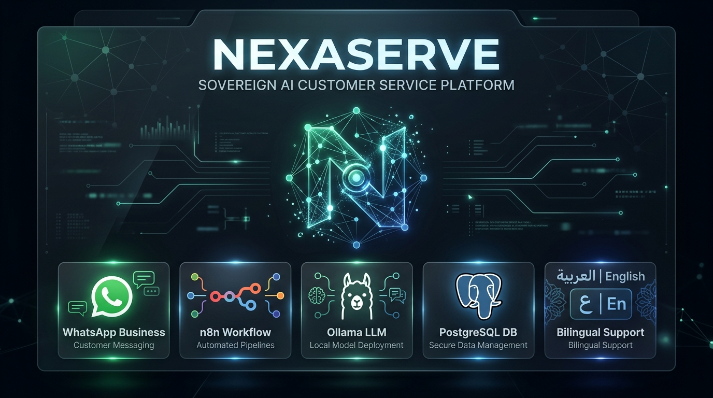
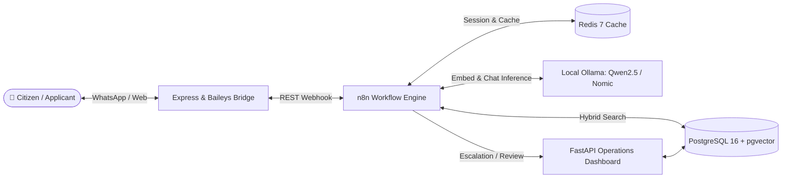
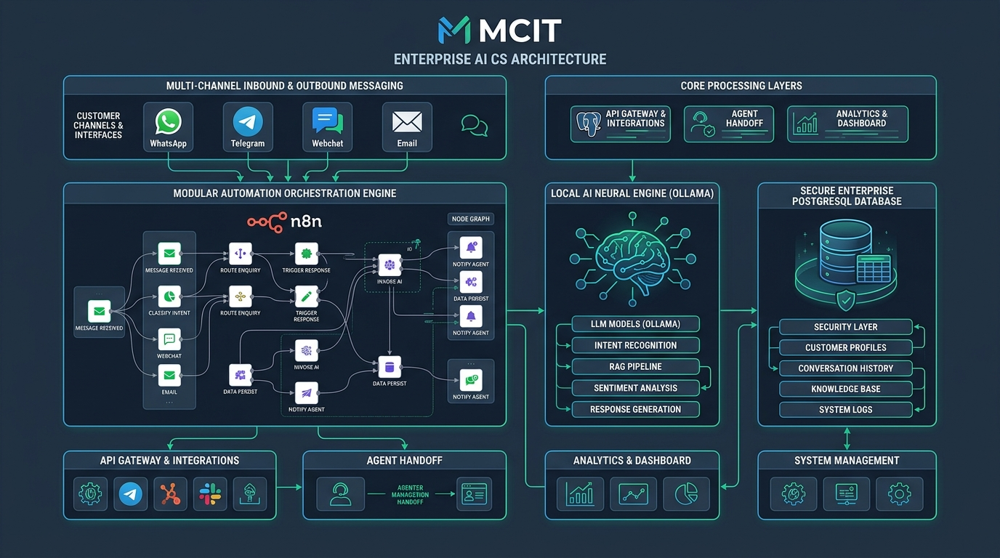
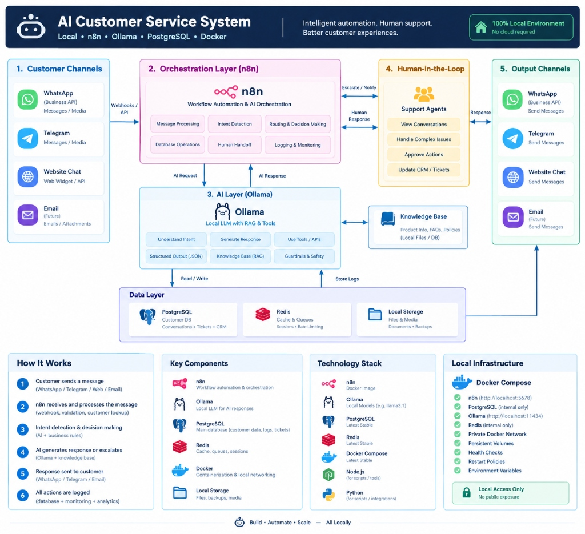
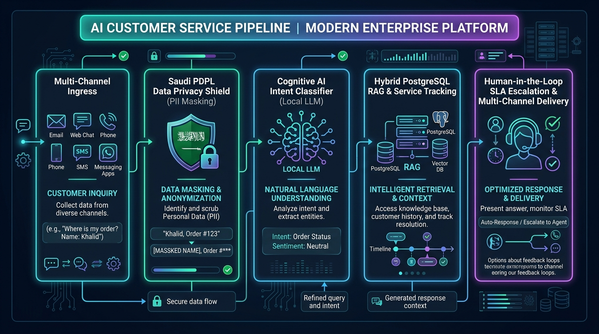
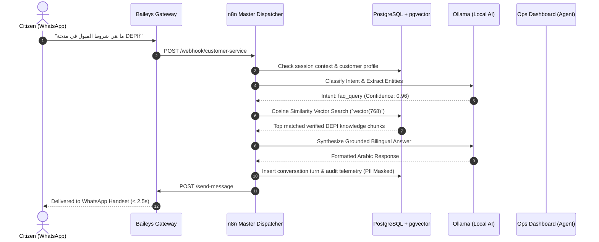
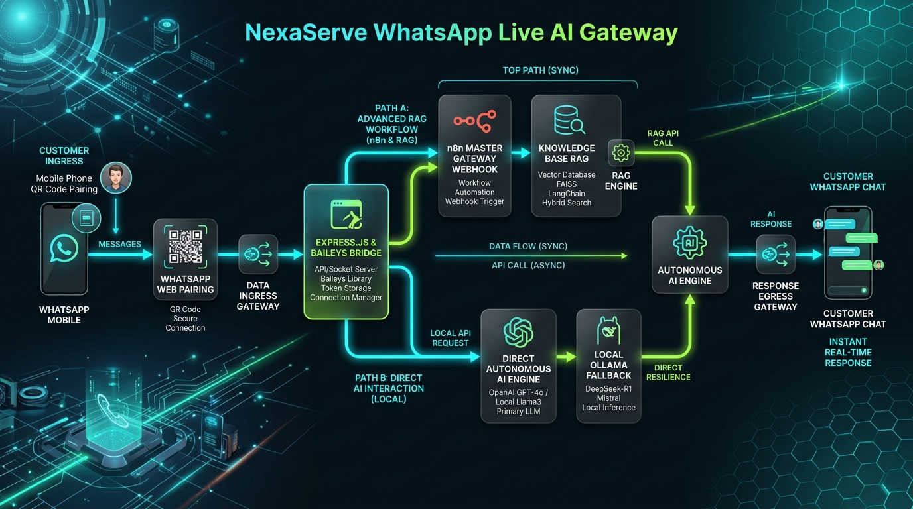
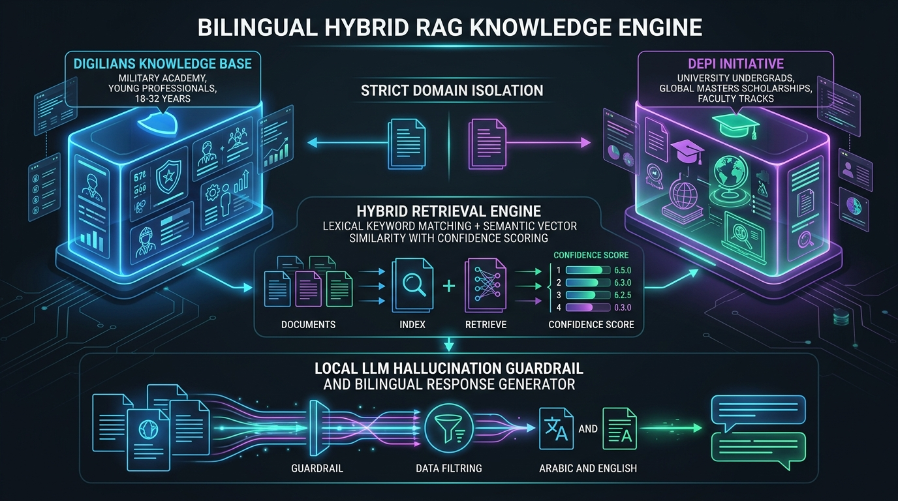
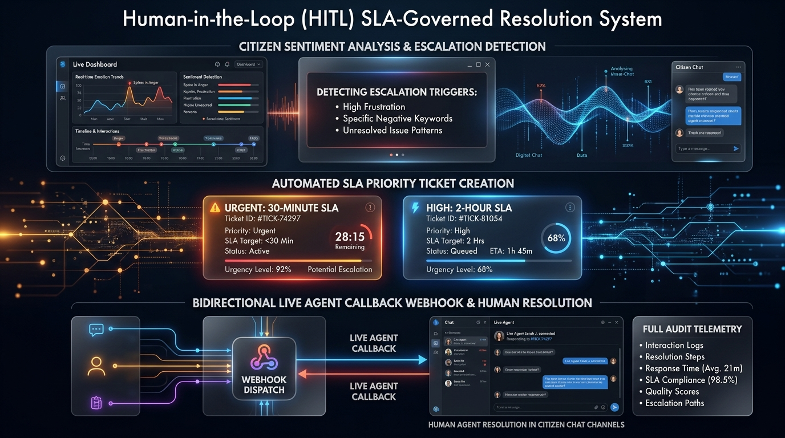

<div align="center">

# 🌟 NexaServe (DEPI Customer Support)
### Sovereign, Autonomous & Local-First AI Customer Support Ecosystem

[](docker-compose.yml)
[-4169E1?style=for-the-badge&logo=postgresql&logoColor=white)](infra/postgres)
[](deployment/assets/n8n/workflows)
[](https://ollama.com)
[](deployment/application/whatsapp)
[](dashboard)

<p align="center">
  
</p>

<p align="center">
  <b>NexaServe</b> is an enterprise-grade, sovereign conversational intelligence platform designed for the <b>Digital Egypt Pioneers Initiative (DEPI)</b> and Ministry of Communications and Information Technology (MCIT). Engineered with strict on-premise data governance, local LLM neural routing, pgvector semantic retrieval, and multi-channel messaging via WhatsApp.
</p>

[Key Capabilities](#-key-capabilities) • [System Architecture](#-system-architecture) • [End-to-End Pipeline](#-end-to-end-pipeline-flow) • [n8n Workflows](#-n8n-workflow-suite) • [Quick Start](#-quick-start--deployment) • [Operations Dashboard](#-operations-dashboard--hitl) • [Verification Suite](#-verification-suite--testing)

---
</div>

## 📑 Table of Contents

- [Overview](#-overview)
- [Key Capabilities](#-key-capabilities)
- [System Architecture](#-system-architecture)
- [End-to-End Pipeline Flow](#-end-to-end-pipeline-flow)
- [WhatsApp Live AI Gateway](#-whatsapp-live-ai-gateway)
- [Bilingual Hybrid RAG Knowledge Engine](#-bilingual-hybrid-rag-knowledge-engine)
- [Operations Dashboard & Human-in-the-Loop](#-operations-dashboard--human-in-the-loop)
- [10 Core n8n Workflows](#-10-core-n8n-workflows)
- [Repository Structure](#-repository-structure)
- [Quick Start & Deployment](#-quick-start--deployment)
  - [Prerequisites](#prerequisites)
  - [Docker Compose Quickstart](#docker-compose-quickstart)
  - [GPU Acceleration Overlay](#gpu-acceleration-overlay)
- [Verification Suite & Testing](#-verification-suite--testing)
- [Security & Governance](#-security--governance)
- [License & Authorship](#-license--authorship)

---

## 🚀 Overview

**NexaServe** eliminates dependency on external third-party cloud APIs, guaranteeing 100% data sovereignty and regulatory compliance. It acts as a 24/7 intelligent tier-1 frontline responder for inquiries regarding DEPI tracks, application qualifications, exams, results, and order/request tracking, backed by human agent escalation when necessary.



---

## ⚡ Key Capabilities

| Capability | Technical Realization | Sovereign Advantage |
|:---|:---|:---|
| **Multi-Channel Ingress** | WhatsApp (Baileys Node.js socket), REST Webhooks, Webchat | Direct handset connection without per-message cloud fees |
| **Cognitive Routing** | Zero-shot intent classification via local LLM (`qwen2.5:3b`) | Real-time classification into FAQ, Order Tracking, or Escalation |
| **Bilingual Hybrid RAG** | PostgreSQL `pgvector(768)` + Full-Text Search (Arabic & English) | High-accuracy retrieval with strict initiative domain isolation |
| **Human-in-the-Loop (HITL)** | Automated ticket opening (SLA timer: 30m urgent, 2h high) | Seamless agent handoff with bidirectional customer callback |
| **Security & Masking** | Egyptian National ID & phone number PII masking before logging | Full compliance with sovereign data protection guidelines |
| **Enterprise Operations** | FastAPI + Vanilla JS dark-glass responsive operations portal | Real-time execution metrics, turn telemetry, and conversation audits |

---

## 🏗️ System Architecture

The overall system architecture decouples transport, workflow orchestration, neural inference, and persistent data layers:

<p align="center">
  
</p>

### Blueprint Overview

<p align="center">
  
</p>

---

## 🔄 End-to-End Pipeline Flow

Inbound inquiries traverse a hardened 5-stage sovereign pipeline from reception to multi-channel delivery:

<p align="center">
  
</p>



---

## 📱 WhatsApp Live AI Gateway

The WhatsApp layer provides a standalone, reliable bridge built with Express and the Baileys WebSocket library:

<p align="center">
  
</p>

- **Visual Web QR Pairing**: Visit `http://localhost:8080/qr` to authenticate your device.
- **Persistent Session Storage**: Preserves session state in Docker named volumes (`whatsapp-auth`).
- **Resilient Fallback Mode**: If n8n orchestration is undergoing maintenance, the gateway can route queries directly to Ollama for emergency continuity.
- **Bi-directional Webhooks**: Handles inbound messages, media events, status updates, and outbound notifications.

---

## 🧠 Bilingual Hybrid RAG Knowledge Engine

The Knowledge Engine achieves state-of-the-art grounded retrieval for DEPI and Digilians programs without cross-initiative contamination:

<p align="center">
  
</p>

1. **Strict Domain Isolation**: Explicit metadata segregation between DEPI and Digilians program taxonomies.
2. **Dense Vector Search**: Powered by `nomic-embed-text` generating 768-dimensional embeddings with cosine distance operator `<=>`.
3. **Sparse Lexical Fallback**: Weighted PostgreSQL full-text search index on Arabic and English question/answer pairs.
4. **Anti-Hallucination Guardrails**: Prompts verify retrieved grounding scores before generation, refusing out-of-scope inquiries safely.

---

## 📊 Operations Dashboard & Human-in-the-Loop

The included FastAPI operations portal offers management, monitoring, and agent intervention capabilities:

<p align="center">
  
</p>

- **Real-Time Telemetry**: Real-time tracking of message rates, system latencies, and sentiment indicators.
- **SLA Ticket Countdown**: Visual urgency tiers with 30-minute and 2-hour SLA alerts.
- **Agent Callback Console**: Human operators can take over escalated chats and send replies directly to the citizen's WhatsApp session.
- **Audit Logging**: Full turn-by-turn history with PII redaction for supervisory auditing.

---

## 🧩 10 Core n8n Workflows

All workflows are modularly designed and exported as canonical JSON definitions in [`deployment/assets/n8n/workflows/`](deployment/assets/n8n/workflows/):

| # | Workflow Name | Description | Export File |
|:---:|:---|:---|:---|
| **01** | **Customer Service Gateway & Dispatcher** | Inbound intake, rate limiting, channel normalization, routing | [`01_gateway_dispatcher.json`](file:///e:/NexaServe/deployment/assets/n8n/workflows/01_gateway_dispatcher.json) |
| **02** | **Customer Profile & Session Manager** | Customer record lookup, memory window management, context | [`02_session_manager.json`](file:///e:/NexaServe/deployment/assets/n8n/workflows/02_session_manager.json) |
| **03** | **AI Cognitive & Intent Engine** | Zero-shot intent classification, entity extraction, routing decisions | [`03_intent_engine.json`](file:///e:/NexaServe/deployment/assets/n8n/workflows/03_intent_engine.json) |
| **04** | **Knowledge Base & FAQ (RAG)** | Dense vector retrieval, hybrid ranking, grounded answer generation | [`04_knowledge_faq.json`](file:///e:/NexaServe/deployment/assets/n8n/workflows/04_knowledge_faq.json) |
| **05** | **Order Lookup & Tracking** | Citizen application/order inquiry lookup against PostgreSQL records | [`05_order_lookup.json`](file:///e:/NexaServe/deployment/assets/n8n/workflows/05_order_lookup.json) |
| **06** | **Human-in-the-Loop Escalation** | Automated SLA priority ticket creation, supervisor alerting | [`06_hitl_escalation.json`](file:///e:/NexaServe/deployment/assets/n8n/workflows/06_hitl_escalation.json) |
| **07** | **Human-in-the-Loop Agent Bridge** | Two-way agent intervention, outbound channel relay, resolution | [`07_hitl_agent_bridge.json`](file:///e:/NexaServe/deployment/assets/n8n/workflows/07_hitl_agent_bridge.json) |
| **08** | **Output Channel Dispatcher** | Channel-specific formatting (WhatsApp text/buttons, web payloads) | [`08_output_dispatcher.json`](file:///e:/NexaServe/deployment/assets/n8n/workflows/08_output_dispatcher.json) |
| **09** | **Conversation & Audit Logger** | Turn-level logging, latency tracking, PII redaction | [`09_conversation_logger.json`](file:///e:/NexaServe/deployment/assets/n8n/workflows/09_conversation_logger.json) |
| **10** | **Global Error Handler & DLQ** | Dead-letter queue captures, graceful user error fallbacks | [`10_error_handler.json`](file:///e:/NexaServe/deployment/assets/n8n/workflows/10_error_handler.json) |

---

## 📁 Repository Structure

```text
.
├── dashboard/                     # FastAPI backend & dark-mode operations dashboard
│   ├── backend/main.py            # API server (analytics, tickets, agents, system status)
│   └── frontend/                  # Responsive web dashboard (HTML, CSS, JS)
├── DEPI_Web_Scraper/              # DEPI portal web scrapers & automated FAQ extractors
├── FAQs/                          # Curated official DEPI & Digilians QA documents
├── infra/                         # Core infrastructure definitions
│   ├── postgres/init.sql          # DB schema (pgvector, knowledge_base, sessions, tickets)
│   ├── n8n/                       # n8n runtime configurations and workflows
│   └── whatsapp/                  # Baileys WhatsApp bridge service
├── docs/                          # Comprehensive technical documentation & architectural diagrams
│   └── images/                    # High-resolution architectural blueprints & diagrams
├── deployment/                    # Production deployment suite (Ubuntu 24.04 LTS / x86_64)
│   ├── assets/n8n/workflows/      # 10 canonical workflow JSON exports
│   ├── compose/                   # Production, GPU, and offline Compose files
│   ├── migrations/                # Additive PostgreSQL migrations
│   └── scripts/                   # Automated deployment, healthcheck, and backup scripts
├── scripts/                       # Local developer & operational test utilities
│   ├── test-whatsapp-e2e.py       # Live WhatsApp end-to-end integration test
│   └── test-depi-enterprise.py    # 23-assertion full platform verification suite
└── docker-compose.yml             # Root developer Compose definition
```

---

## 🛠️ Quick Start & Deployment

### Prerequisites
- **Docker Engine** 24.0+ & **Docker Compose v2**
- **NVIDIA GPU** (Optional for acceleration; 8GB+ VRAM recommended)
- **Ollama** installed locally or running via Compose

### Docker Compose Quickstart

1. **Clone the repository:**
   ```bash
   git clone https://github.com/MCIT-DEPI/DEPI-Customer-Support.git
   cd DEPI-Customer-Support
   ```

2. **Configure environment variables:**
   ```bash
   cp .env.example .env
   # Edit .env with your PostgreSQL credentials, security secrets, and host configuration
   ```

3. **Start the core services:**
   ```bash
   docker compose up -d
   ```

4. **Verify container health:**
   ```bash
   docker compose ps
   ```

5. **Connect WhatsApp:**
   Open `http://localhost:8080/qr` in your browser and scan the displayed QR code with your WhatsApp application.

6. **Access Interfaces:**
   - **n8n Workflow Canvas**: [http://localhost:5678](http://localhost:5678)
   - **Operations Dashboard**: [http://localhost:8090](http://localhost:8090)
   - **WhatsApp Pairing Portal**: [http://localhost:8080/qr](http://localhost:8080/qr)

### GPU Acceleration Overlay

To leverage an NVIDIA GPU on Ubuntu Server 24.04:
```bash
cd deployment
bash scripts/03_install_nvidia_toolkit.sh
bash scripts/deploy.sh gpu
```

---

## 🧪 Verification Suite & Testing

The repository contains automated validation suites to ensure every component functions properly:

```bash
# Run the complete 23-assertion platform test suite:
python scripts/test-depi-enterprise.py
```

```text
======================================================================
 🚀 DEPI Enterprise AI Customer Service - Verification Suite
======================================================================
[1] Testing WhatsApp Ingress: Arabic Knowledge Base RAG Query...     [PASS]
[2] Testing Multi-Channel Ingress: Citizen E-Service Tracking...    [PASS]
[3] Testing Security Shield: Egyptian National ID PII Masking...    [PASS]
[4] Testing Cognitive AI: Intent Engine & Sentiment Analysis...      [PASS]
[5] Testing Human-in-the-Loop: SLA Ticket Generation & Priority...   [PASS]
[6] Testing Human Agent Bridge: Callback & Ticket Resolution...     [PASS]
[7] Testing Database Telemetry: PostgreSQL Audit Log Persistence...  [PASS]
======================================================================
 Final Test Results: Passed: 23 | Failed: 0 (100% Pass Rate)
======================================================================
```

To test live bidirectional WhatsApp messaging:
```bash
python scripts/test-whatsapp-e2e.py
```

---

## 🔒 Security & Governance

- **Zero Cloud Leakage**: Conversation content and vectors remain within your infrastructure.
- **Built-in PII Redaction**: Egyptian National IDs (14 digits) and phone numbers are scrubbed prior to audit logging.
- **Scoped Ingress**: Database, Redis, and Ollama ports remain closed to the external network by default.
- **Fail-Safe Operation**: Unhandled runtime exceptions route to the Dead-Letter Queue (DLQ) with user-friendly notices.

---

## 📜 License & Authorship

Developed for the **Digital Egypt Pioneers Initiative (DEPI)** under the auspices of the **Ministry of Communications and Information Technology (MCIT)**.

<div align="center">
  <b>NexaServe</b> • Built for Sovereign Government Customer Service Automation.
</div>
